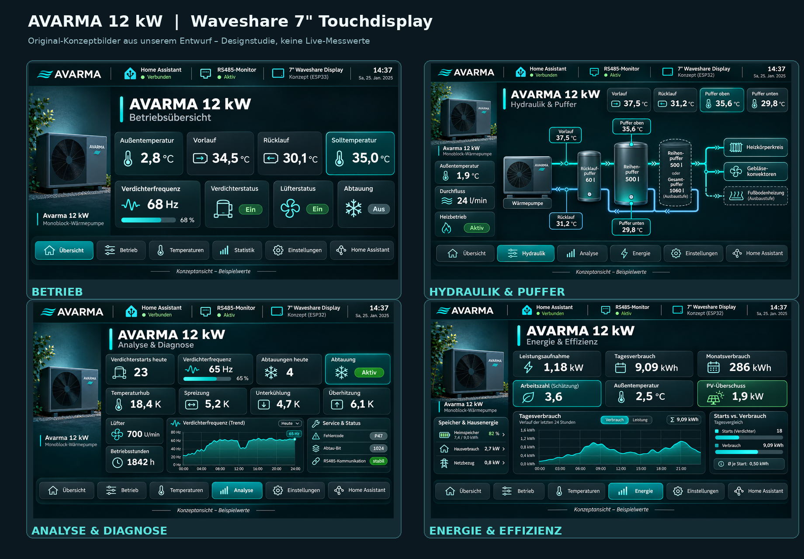
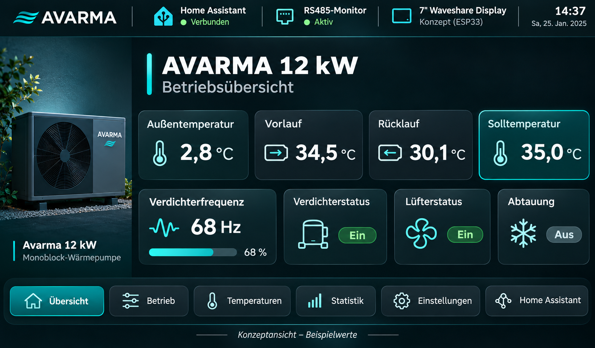
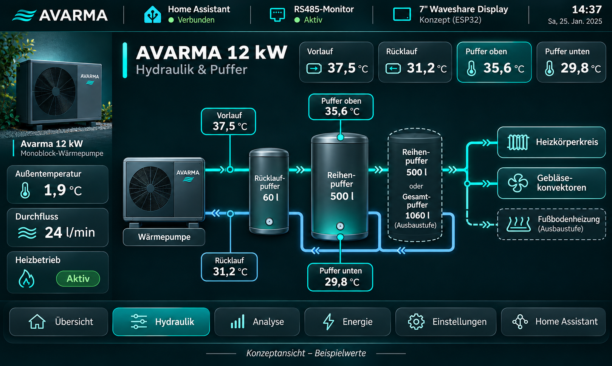
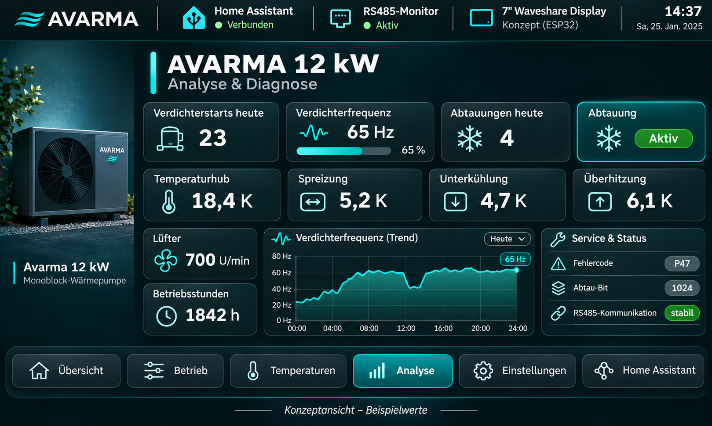
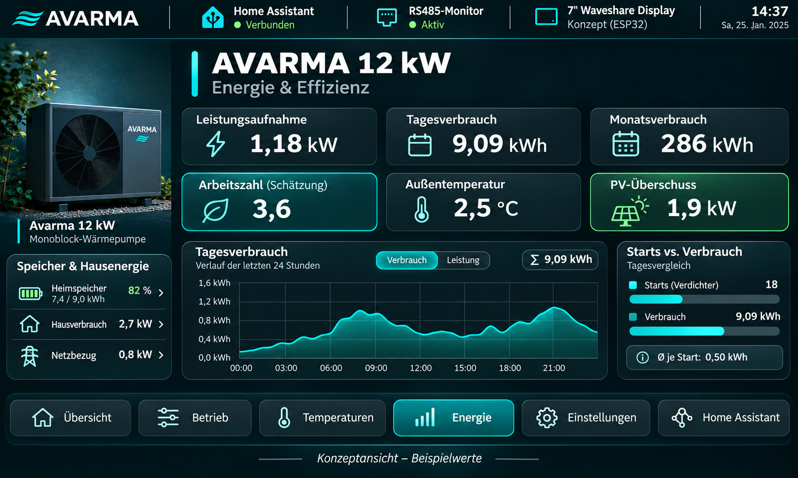
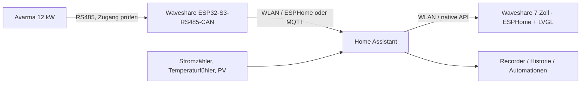

# Avarma 12 kW – 7" Touchdisplay für Home Assistant

### Projektankündigung · Konzeptphase 🚧

   


Ein separates Open-Source-Projekt für die **Avarma 12 kW Monoblock-Wärmepumpe** mit einem **7" Waveshare ESP32-Touchdisplay** als lokales Bedien-, Monitoring- und Diagnosepanel.

Ziel ist eine moderne, klar strukturierte Oberfläche für **Heizbetrieb, Pufferspeicher, Verdichterdaten, Abtauung, Starts, Energieverbrauch und Home-Assistant-Integration** – speziell für die Avarma 12 kW im praktischen Einsatz.

> **Status:** Dies ist eine **Vorankündigung mit Konzeptidee**, noch keine fertige Firmware. Die dargestellten Inhalte beschreiben den geplanten Funktionsumfang. Die tatsächliche Registerzuordnung, Datenverfügbarkeit und spätere Steuerbarkeit müssen an der realen Avarma 12 kW verifiziert werden.

---

## Konzeptbilder



Die folgenden vier Ansichten bilden den Entwurfsstand für das 7-Zoll-Touchdisplay ab. **Alle Zahlen sind Beispieldaten; die gezeichnete Hydraulik ist nur eine Designskizze und kein verbindlicher Installationsplan.**

### Betriebsübersicht


Großanzeige für Außentemperatur, Vorlauf, Rücklauf, Solltemperatur, Verdichterfrequenz und Abtauung. Betriebsart und tatsächlicher Verdichterzustand sollen klar unterscheidbar sein.

### Hydraulik und Rücklaufpuffer


Die reale Anlage besitzt einen **60-l-Rücklaufpuffer**. Geplant sind zwei zusätzliche 500-l-Reihenpuffer, sodass das Puffervolumen auf **1.060 l** steigen soll. Die endgültige Anzeige bildet die realen Messstellen und die tatsächliche Reihenfolge im Rücklauf ab. Optional sind Heizkörper, Gebläsekonvektoren und eine spätere Fußbodenheizung vorgesehen.

### Analyse und Diagnose


Zusammenführung von Verdichterstarts, Frequenz, Laufzeit, Abtauungen, Temperaturhub und Spreizung. Zusätzlich Überhitzung und Unterkühlung, **nur soweit aus verlässlichen Sensordaten ableitbar**. Unplausible Messwerte sollen als solche markiert werden.

### Energie und Effizienz


Leistungsaufnahme, kWh pro Tag/Monat, Kurven, PV-Überschuss und Vergleich der Taktung mit dem Energieverbrauch. Eine Arbeitszahl wird bei fehlender Wärmemengenmessung ausdrücklich als **Schätzung** bezeichnet.

---

## Warum ein eigenes Repository?

Die **Avarma 12 kW** unterscheidet sich in ihrer Nutzung deutlich von der Brauchwasserwärmepumpe:

- Fokus auf **Heizbetrieb statt Warmwasser-only**
- Relevanz von **Vorlauf, Rücklauf, Außentemperatur, Verdichterfrequenz und Abtauung**
- Einbindung von **Pufferspeichern, Heizkreisen und Volumenstrom**
- Interesse an **Verdichterstarts, Taktung, Effizienz und Langzeitanalyse**
- Ziel einer kompakten **7-Zoll-Bedien- und Diagnoseoberfläche** direkt für die Wärmepumpe

Daher soll dieses Repository **eigenständig** aufgebaut werden – getrennt von den Projekten zur Avarma-BWWP und zur ALSAVO iHeat.

---

## Projektidee

Das Projekt soll ein **Waveshare 7" ESP32-Touchdisplay** mit **Home Assistant**, **ESPHome / LVGL** und einer geplanten **RS485-Anbindung** kombinieren.

Im ersten Schritt liegt der Fokus auf:

- **Visualisierung** relevanter Betriebsdaten
- **Langzeitmonitoring** in Home Assistant
- **Diagnose** von Taktung, Abtauung und Betriebszuständen
- **Analyse** von thermodynamischen Größen und Anlagenverhalten

Spätere Steuerfunktionen sind denkbar, sollen aber **erst nach sicherer Kommunikation und verifizierten Schreibzugriffen** umgesetzt werden.

---

## Geplanter Funktionsumfang

### 1. Betriebsübersicht
- Außentemperatur
- Vorlauf- und Rücklauftemperatur
- Solltemperatur / Heizkurvenbezug
- Verdichterstatus
- Verdichterfrequenz
- Lüfterstatus
- Aktueller Betriebsmodus
- Anzeige von Abtauung und Sperrzeiten

### 2. Pufferspeicher & Hydraulik
- Temperatur oben / unten im Reihenpuffer
- Rücklauf zum Verdampfer / aus dem Puffer
- Visualisierung der Hydraulik
- Heizkreise / Verbraucher
- Volumenstrom (soweit verfügbar)
- Hinweise auf Taktung und Pufferwirkung

### 3. Diagnose & Analyse
- Verdichterstarts pro Tag
- Laufzeiten
- Abtauzyklen
- Temperaturhub
- Unterkühlung / Überhitzung (falls verfügbar)
- Spreizung
- Bit-/Statusanzeige für Abtauung und Betriebszustände
- Fehler- und Warnmeldungen

### 4. Energie & Effizienz
- Aktuelle Leistungsaufnahme
- Tagesverbrauch
- Wochen- / Monatswerte
- Arbeitszahl / COP-Schätzung
- Vergleich von Außentemperatur, Leistung und Taktung
- Einbindung in PV- und Batteriesysteme über Home Assistant

### 5. Service & Einstellungen (später)
- Parameterauswahl
- Zeitprogramme
- UI-Helligkeit / Nachtmodus
- Kommunikationsstatus
- Firmware- und Versionsanzeige
- Optionale Steuerfunktionen nach gesicherter Protokollanalyse

---

## Geplante Displayseiten

### Seite A – Start / Betrieb
Große Kachelansicht für:
- Außentemperatur
- Vorlauf / Rücklauf
- Solltemperatur
- Verdichterfrequenz
- Betriebsstatus
- Abtauung aktiv / inaktiv

### Seite B – Hydraulik
Schemaansicht mit:
- Wärmepumpe
- Puffer
- Heizkreis(en)
- Rücklaufpfad
- Temperatursensoren
- Flussrichtung

### Seite C – Analyse
Technikseite für:
- Verdichterstarts
- Laufzeit
- Abtauungen
- Temperaturhub
- Spreizung
- Überhitzung / Unterkühlung
- Register- und Statuswerte

### Seite D – Energie
Übersicht für:
- aktuelle Leistung
- Tagesverbrauch
- Trendkurven
- Arbeitszahl
- PV-Überschuss / Batteriespeicher (über Home Assistant)

### Seite E – Service
Spätere Seite für:
- Kommunikationsdiagnose
- Firmwarestatus
- Parameterzugriff
- Nachtmodus / Displayeinstellungen

---

## Konzept: Einbindung in Home Assistant

**Der vorhandene Waveshare ESP32-S3-RS485-CAN soll die Wärmepumpendaten bereitstellen; das neue 7-Zoll-Panel ist ein davon unabhängiges Anzeigegerät.** Damit müssen weder die Modbus-Kommunikation noch die Originalsteuerung geändert werden, wenn später die Touchoberfläche überarbeitet wird.



### 1. Kommunikationsschicht

Ausgangspunkt sind die bereits erprobten RS485-/Home-Assistant-Arbeiten an der Avarma-Monoblock-Wärmepumpe. Vor dem Ausbau werden **Registeradressen, Skalierung, Polling, Datenqualität und Fehlerverhalten** geprüft. Das im Projekt beobachtete **Abtau-Statusbit 1024** wird als geräte- und firmwareabhängige Beobachtung dokumentiert. Es ist kein allgemeingültiger Herstellerstandard.

> **RS485-Sicherheit:** Läuft das Originaldisplay bereits als Modbus-Master, darf der ESP32 nicht ungeprüft als zweiter Master parallel senden. Der genaue Busaufbau bestimmt, ob passives Mithören, ein freigegebener zusätzlicher Port oder ein getesteter Ersatz der Displaykommunikation möglich ist. Kritische Schreibzugriffe sind zunächst deaktiviert.

### 2. Datenhaltung und Berechnungen

Home Assistant übernimmt Sensoren, Historie und abgeleitete Kennwerte. Geplante Gruppen:

| Bereich | Daten | Quelle |
| --- | --- | --- |
| Betrieb | Verdichter, Frequenz, Lüfter, Abtauung, Fehler | Validierte RS485-Daten |
| Hydraulik | VL/RL, Volumenstrom, Puffertemperaturen | RS485 und externe Temperaturfühler |
| Taktung | Starts je Tag, Laufzeit, Abtauzyklen | HA-Templates mit Entprellung |
| Energie | Leistung, Tagesverbrauch, PV-/Batteriedaten | Stromzähler und vorhandene HA-Integration |
| Kältekreis | Temperaturhub, Unterkühlung, Überhitzung | Nur plausibilisierte Messwerte und Berechnungen |

Beim Pufferausbau werden die beiden vorgesehenen externen Temperatursensoren mit **Messort und Einbauhöhe** dokumentiert. Aus nur zwei Punkten lässt sich keine vollständige Temperaturschichtung über alle Speicher rekonstruieren.

### 3. Waveshare-7-Zoll-Frontend

Vorgesehen ist das **Waveshare ESP32-S3-Touch-LCD-7B (1024 × 600)** mit **ESPHome/LVGL**. Das Touchdisplay erhält seine Werte aus Home Assistant und wird zunächst **ausschließlich lesend** umgesetzt. Zuerst werden Displaycontroller, Touchfunktion, Hintergrundbeleuchtung und **Kaltstart nach vollständiger Stromtrennung** geprüft.

Zukünftige Bedienfunktionen (z. B. Solltemperatur) sind erst nach Prüfung des jeweiligen Parameters, zulässiger Wertebereiche und sicherer Rücklesekontrolle vorgesehen. **Störungs- und Schutzfunktionen bleiben Aufgabe der originalen Wärmepumpensteuerung.**

### 4. Verfügbarkeit und Fehlermodi

Die GUI soll bei WLAN- oder HA-Ausfall nicht einfach die letzten Werte als aktuell zeigen: Ein **Zeitstempel bzw. „Daten veraltet“** kennzeichnet fehlende Kommunikation. Nach einem Neustart muss das Panel wieder selbstständig anlaufen. Langzeitdaten bleiben in Home Assistant erhalten.

---

## Mögliche Hardwarebasis

| Komponente | Aufgabe |
| --- | --- |
| Avarma 12 kW Monoblock | Heizungswärmepumpe |
| Waveshare ESP32-S3-RS485-CAN | Geplante RS485-Schnittstelle / Busmonitor |
| Waveshare ESP32-S3-Touch-LCD-7B | 7" Touchpanel |
| Home Assistant | Zentrale Daten- und Automationsplattform |
| ESPHome / LVGL | Geplante Display- und UI-Umsetzung |

---

## Roadmap

- [x] Projektidee definieren
- [x] Repository-Vorankündigung vorbereiten
- [ ] Hardware- und Kommunikationsbasis dokumentieren
- [ ] RS485 / Displaybus analysieren
- [ ] Sensor- und Statuswerte identifizieren
- [ ] Vorhandene Home-Assistant-Entitäten und Register dokumentieren
- [x] Erste 7"-Konzeptbilder entwerfen
- [ ] Betriebsübersicht umsetzen
- [ ] Hydraulik- und Analyseansicht umsetzen
- [ ] Energie- und Effizienzseite ergänzen
- [ ] Langzeittest / Optimierung
- [ ] Dokumentation und öffentliche Veröffentlichung

---

## Abgrenzung zu anderen Projekten

Dieses Repository ist vorgesehen für:
- **Avarma 12 kW Monoblock**
- Schwerpunkt **Heizung / Hydraulik / Analyse**

Getrennte Repositories sind sinnvoll für:
- **Avarma BWWP 300 l** → Schwerpunkt Warmwasser / Betriebsarten / Speicher
- **ALSAVO iHeat 07i9** → Schwerpunkt Heizbetrieb mit eigener Hydraulik und eigener UI-Linie

---

## Geplante Zielsetzung

Das langfristige Ziel ist ein **eigenes, technisch aussagekräftiges Touchpanel** für die Avarma 12 kW – mit deutlich mehr Informationen als das Originaldisplay und einer engen Verzahnung mit Home Assistant.

Dazu gehören perspektivisch:
- bessere Übersicht im Heizbetrieb
- Analyse der Taktung und Pufferwirkung
- schnell erkennbare Abtau- und Verdichterzustände
- Visualisierung wichtiger Kennwerte für Optimierung und Fehlersuche

---

## Dateien und Upload auf GitHub

```text
avarma-12kw-waveshare-touch/
├── README.md
└── assets/
    ├── betrieb.png
    ├── hydraulik.png
    ├── diagnose.png
    └── energie.png
```

**Wichtig:** Die ZIP-Datei zuerst entpacken und danach die `README.md` und den Ordner `assets` ins **Hauptverzeichnis** des GitHub-Repositories hochladen. GitHub entpackt ein direkt hochgeladenes ZIP nicht automatisch.

## Hinweis

Dieses Projekt ist ein **unabhängiges Community-Projekt**. Es handelt sich nicht um eine offizielle Software des Herstellers. Arbeiten an Wärmepumpensteuerungen, elektrischen Anschlüssen und Kommunikationsschnittstellen erfordern entsprechende Fachkenntnisse.

---

**Projekt von [AWendt206](https://github.com/AWendt206)**  
Avarma · Home Assistant · ESP32 · Waveshare · RS485 · Wärmepumpenmonitoring
